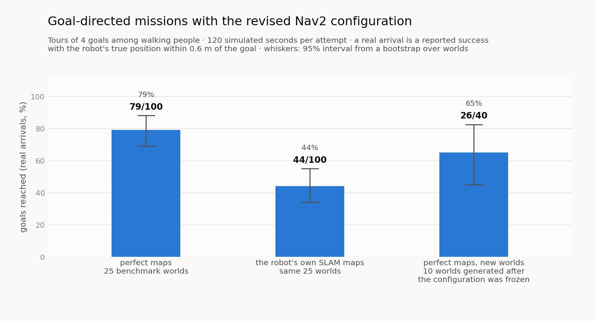
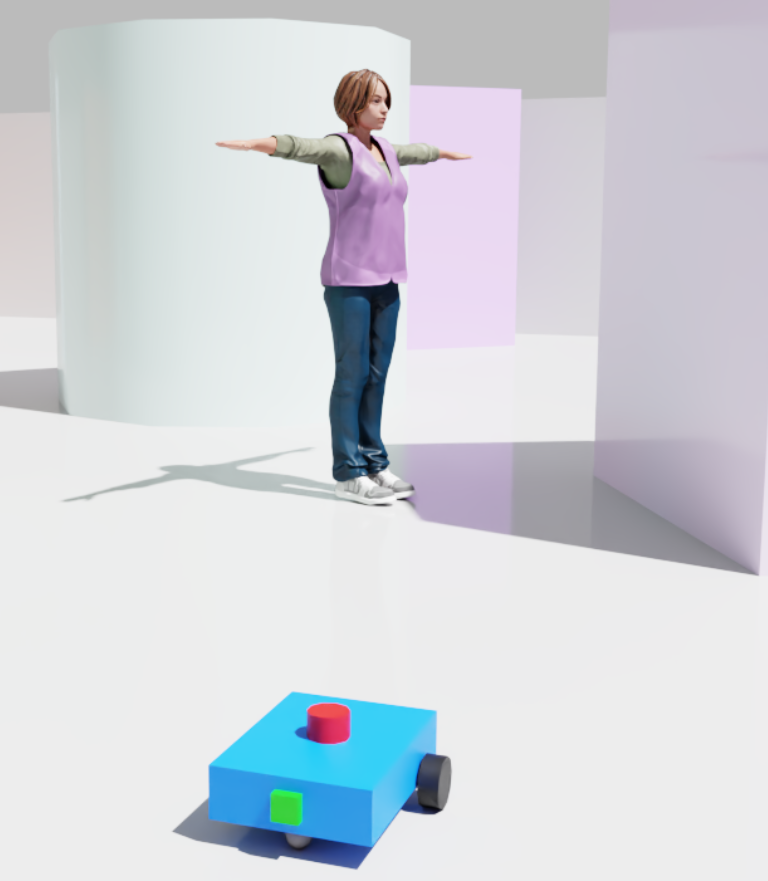
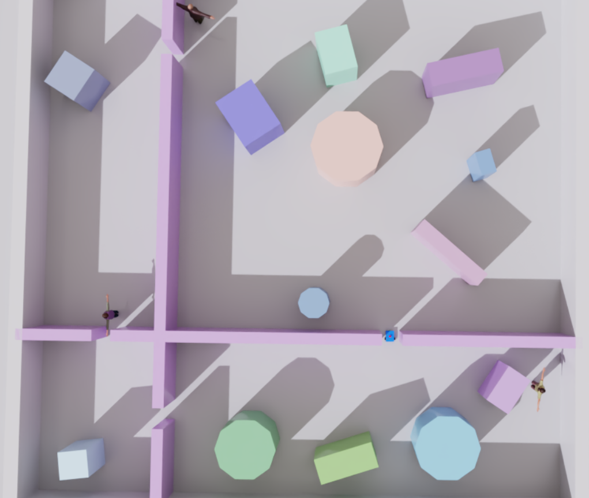
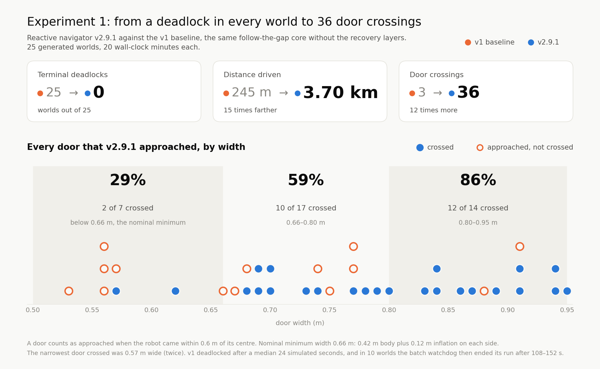
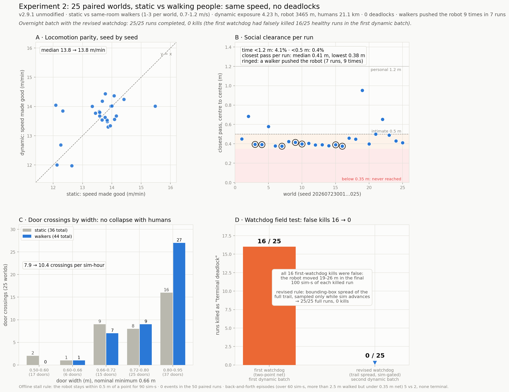
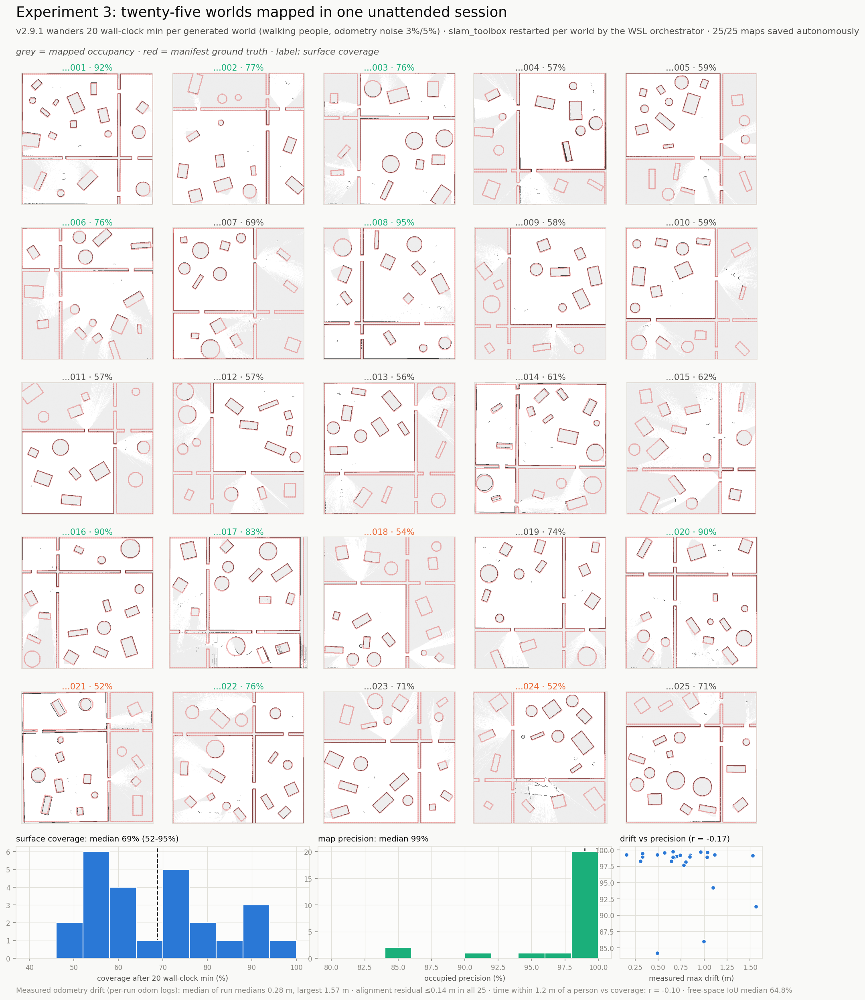
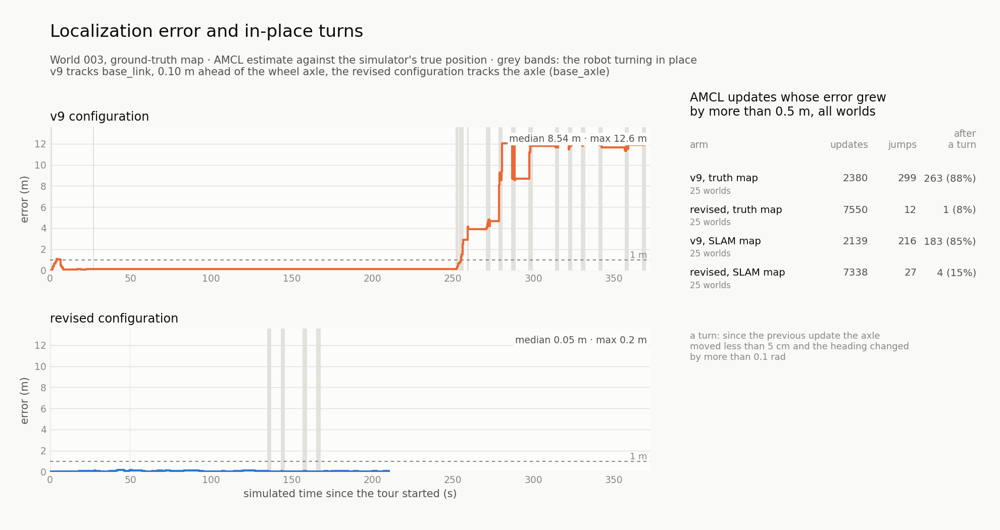
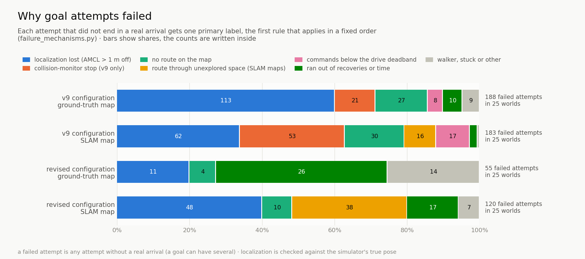

# Indoor navigation among walking people: a measured pipeline in Isaac Sim

This repository contains a simulation benchmark I built to answer one question in stages: what does it take for a wheeled robot to move with purpose through cluttered rooms while people walk around it?

Everything runs in NVIDIA Isaac Sim 6.0 with ROS 2 Jazzy (Nav2 1.3.12) on WSL2. The robot is a 0.42 m differential-drive platform with a 360-ray lidar and a camera. Worlds are generated procedurally from a seed: four rooms, doors of controlled width, random furniture, and three people, who stand still or walk scripted routes. Every claim below is checked against simulator ground truth, not against the robot's own estimates. The full pipeline ran on a single RTX 2080 Ti, below the simulator's minimum spec, at real-time factors between 0.15 and 0.55.

Author: Dimitrios Gkiokas (dimitris.gkiokas@outlook.com)

Technical report: [`report_gkiokas_2026.pdf`](docs/report_gkiokas_2026.pdf) (also attached to [Release v1.0](../../releases/tag/v1.0)) · All figures with captions: [FIGURES.md](docs/FIGURES.md)

## In short

- A reactive navigator (experiments 1 to 3) went from a terminal deadlock in all 25 worlds to none, kept working among walking people and mapped all 25 worlds unattended.
- The first complete mission tests with Nav2 on those maps (experiments 4 and 5) reached 11 and 12 of 100 goals. Perfect maps of the same worlds showed that the maps were not the main limit: under a stricter protocol the same configuration reached 6 of 100 goals on perfect maps and 9 on its own maps (experiments 6 and 5b).
- Eight changes to the Nav2 configuration, each tied to a failure in the logs, raised this to 79 of 100 goals on perfect maps and 44 of 100 on the robot's own maps, in the same worlds under the same protocol (experiments 7 and 8). On 10 worlds generated after the configuration was frozen it reaches 26 of 40.
- What still holds the robot back on its own maps is the space the maps never covered: localization drifts where little of the map is known, and the planner routes through unexplored space that is in fact blocked.

<em>The robot and one of the walkers, path-traced in Isaac Sim. The people are unanimated meshes moved along scripted routes. The camera sees the character mesh, the lidar a 0.25 m cylinder that moves with each person.</em>

<em>One world from above, paused mid-run: four rooms, doors in the partition walls, seeded furniture, three people on their routes. The robot is mid-crossing in the central doorway.</em>

## Demo

https://github.com/user-attachments/assets/2eda9605-6167-463c-b3ef-dac336a959df

The reactive navigator coming through a doorway, recorded live in the simulator. The footage plays at 1.5× to offset the below-real-time simulation rate on this GPU. The clip also lives in the repository as [`docs/demo.mp4`](docs/demo.mp4).

## Results

The experiments build on each other. Experiments 1 to 5 are the first complete pass through the pipeline. Experiments 6 to 9 rebuild the evaluation of the missions and improve the navigation stack. All plots and numbers are produced by the scripts in `analysis/` from the logs in `runs/`. The complete set of figures, with captions, is in [FIGURES.md](docs/FIGURES.md).

### 1. Reactive navigation vs door width

25 seeded worlds, one run of 20 wall-clock minutes each (about 11 simulated minutes). A follow-the-gap navigator with layered recovery behaviours (v2.9.1) explores on its own, and the analysis counts every door it approaches and crosses. It crossed 12 of the 14 approached doors between 0.80 and 0.95 m wide, 10 of 17 between 0.66 and 0.80 m, and 2 of 7 below 0.66 m, the nominal minimum (0.42 m body plus 0.12 m inflation on each side). Only 38 of the 100 doors were approached at all, so the counts are small and the figure shows a trend, not a sharp threshold. In the same worlds the v1 baseline, the same follow-the-gap core without the recovery layers, reached a terminal deadlock in all 25 runs (median onset 24 s), and v2.9.1 in none.

### 2. The cost of walking people

The same 25 worlds under three conditions: the three people standing still, 1-3 of them walking routes inside their rooms, and the same with one person per world walking through a door between rooms. All 75 runs completed with no terminal deadlock, and the median exploration speed did not change (13.8, 13.8 and 13.9 m/min). The cross-room walker doubled the robot's encounters at the contested door (robot and walker both within 1.5 m of it, 26 to 54) and the robot kept using the contested doors (17 crossings in both conditions).

The walkers follow their routes without yielding, and they do walk into the robot. The robot is about 0.4 m wide and each person's collision cylinder has a 0.25 m radius, so their shapes meet at roughly 0.40-0.45 m centre to centre, and most walking runs had a closest pass below 0.45 m. A hard contact shows up in the log as the robot moving faster than 1 m/s (its top speed is 0.4 m/s) with a person within 0.5 m. Across all walking batches, the robot moved away from the person in 39 of the 41 such events, so it was being pushed. Hard pushes happened in 7 of the 25 same-room runs and 12 of the 25 cross-room runs, mostly from the side or from behind, and never with the people standing still. These counts are a lower bound, since lighter contacts do not move the robot that fast. The closest pass, 0.27 m centre to centre, was one of them: the cross-room walker came up behind the robot at a 0.67 m door and pushed it 3 m. The navigator's person braking only looks at the middle third of the forward camera image, so this walker never registered.

### 3. Mapping while people walk

The robot maps each of the 25 worlds with slam_toolbox while odometry noise (3% linear, 5% angular, measured drift up to 1.57 m) and walking people are active. 25 of 25 maps were saved autonomously in one unattended session. Time spent within 1.2 m of a person is barely correlated with map coverage (r = -0.10), and in a single-world test the walking people left a trace of 0.16 m² in the map, while the same people frozen in place left 0.36 m². Coverage, not accuracy, limits the maps: a median 99.0% of the occupied cells in a map are real walls or furniture (range 84.2-99.8%), but 20 wall-clock minutes of reactive exploration (about 10 simulated minutes) cover a median 68.7% of the wall surface (range 51.5-94.5%).

### 4. Goal-directed missions on self-built maps

Nav2 (AMCL + NavFn + DWB) drives four-goal tours in every world, using only the map from experiment 3, with baseline AMCL settings (v8, `ros/nav2_params_v8.yaml`) and 240 wall-clock seconds per attempt. An offline reachability check at the planner's radius says 85 of 100 goals are feasible on those maps. The robot truly reaches 11 (within 1.5 m of the goal): 7 of the 60 cross-room goals the check calls feasible, plus 4 returns home, three of them in worlds it never left. Nav2 also reported 6 arrivals that never happened, in 4 worlds. Three of them are a Nav2 bug I traced later: in world 006 the first two goals and in world 017 the first goal were reported reached while the robot still stood at the spawn point ([details](#a-start-up-bug-in-nav2-1312)). The other three were reported 1.6 to 5.8 m from the goal after the robot had driven, most likely because AMCL had lost track. In 4 worlds the robot stayed wedged while its goals timed out, and in 4 more the map seals the spawn room at the planner's radius (in world 001 the true geometry does too), so the planner refused every cross-room goal.

### 5. The paired AMCL experiment

The same 25 tours again with AMCL tuned for sparse maps (v9, `ros/nav2_params_v9.yaml`: 500-4000 particles instead of 300-1500, a wider motion model, more tolerance for beams the map does not explain). Real arrivals barely move, from 11 to 12. The three arrivals reported at the wrong place disappear, and the failures change form: the robot now stays wedged until the goal times out (wedged worlds 4 to 8). World 007 reported all four goals within 4.3 s without moving, the start-up bug again, and is excluded. Tuning removed the wrong-place arrivals without raising the real ones, and map coverage correlated only weakly with real arrivals (r = 0.28 and 0.39). My hypothesis at the time was that the maps set the ceiling, since 20 minutes of wandering leave parts of each world unmapped. Experiment 6 tests it.

### 6. Map or stack? (experiments 6, 7, 8 and 5b)

To separate the maps from the navigation stack, I rendered a perfect map of every world from its manifest (`analysis/make_truth_map.py`, same resolution and frame as the SLAM maps) and ran two configurations on both kinds of map, in the same 25 worlds: v9 on perfect maps (experiment 6) and on SLAM maps (5b), the revised configuration on perfect maps (8) and on SLAM maps (7). The protocol changed for all four arms. Each attempt gets 120 simulated seconds, read from the simulator's own log, so a slow real-time factor no longer shortens an attempt. A failed goal is retried once after 10 simulated seconds. A real arrival is a reported success with the robot's true position within 0.6 m of the goal. Every row of every mission log carries the configuration and the kind of map, and every log but those of experiment 6 also the md5 of the parameter file it ran with.

| Real arrivals, 100 goals in 25 worlds | Perfect map | The robot's own SLAM map |
|---|---|---|
| First configuration (v9) | 6 (95% interval 2-11) | 9 (4-15) |
| Revised configuration | 79 (69-88) | 44 (34-55) |

The intervals come from a bootstrap over worlds, the unit of analysis, since the four goals of a tour are not independent. Nav2 reported 3 arrivals that ground truth rejects: 1 for v9 on perfect maps, 2 for the revised configuration on SLAM maps. Paired by world:

- Revised vs v9 on perfect maps: +2.92 goals per world (95% interval +2.48 to +3.32), better in 24 worlds and worse in none (sign test p = 1.2 × 10⁻⁷).
- Revised vs v9 on SLAM maps: +1.40 (+0.92 to +1.92), better in 18, worse in 1 (p = 7.6 × 10⁻⁵).
- Perfect vs SLAM map, revised configuration: +1.40 (+0.92 to +1.84), better in 20, worse in 3 (p = 4.9 × 10⁻⁴).
- Perfect vs SLAM map, v9: -0.12 (-0.40 to +0.20), better in 3, worse in 6 (p = 0.51).

With v9 the map made no difference, because the stack failed before the map could matter. With the revised configuration a perfect map is worth 1.4 goals per world, and that gap is what section 9 looks into. The offline check calls 98 of the 100 goals feasible on the perfect maps and 95 on the SLAM maps at the revised planner radius, so neither kind of map explains the gap by itself.

### 7. What the revised configuration changes

`ros/nav2_params.yaml` changes eight settings of v9, each answering a failure seen in the experiment 6 logs and the ground truth. The header of the file gives the full reasoning. The configuration was developed on six separate development worlds and frozen before experiments 7 and 8.

| # | Change | What went wrong with v9 |
|---|---|---|
| 1 | Controller, local costmap and recoveries work in `base_axle`, a frame on the wheel axle 0.10 m behind the lidar | Their motion models turned the robot about the chassis centre, a point it does not turn about |
| 2 | Footprint: the true body outline plus 2 cm, as a polygon | A 0.22 m circle, which missed the chassis corners at 0.25 m |
| 3 | Planner radius 0.25 m instead of 0.30 m | The robot stopped closer to obstacles than the planner accepts as a start, so later goals could not be planned (27 of the 188 failed attempts on perfect maps had no route from where the robot stood) |
| 4 | Reverse passes the velocity smoother | DWB asked for reverse and the smoother clamped it to zero |
| 5 | Collision monitor out of the command path | Its 0.23 m stop circle froze the robot for the rest of the tour after one close pass (21 failed attempts on perfect maps, 53 on SLAM maps) |
| 6 | Behaviour tree that replans only when the path becomes invalid | With a replan every second, one failed replan in a door mouth stopped the controller and started the recoveries inside the door |
| 7 | AMCL tracks the wheel axle (7a) and injects no random particles (7b) | See below |
| 8 | No commands inside the drive's deadband (DWB `min_speed_xy` 0.03 m/s, `min_speed_theta` 0.15 rad/s) | 39% of the commands were slower than the simulated drive moves, so the robot crept on the spot until the progress checker gave up |

Change 7a matters most. With AMCL tracking the chassis centre, an in-place turn moves the tracked frame sideways on a 0.10 m circle. Nav2's differential motion model reads each such step as a translation at a 90° bearing and spreads the particles by about 45° and 1 m at every filter update during the turn. Of the 299 AMCL updates in experiment 6 whose error grew by more than 0.5 m, 263 (88%) came right after an in-place turn. With the revised configuration there were 12 such jumps in 7550 updates.

### 8. Checks: new worlds, repeated worlds, one change left out

The eight changes came from logs of the 25 benchmark worlds, so three checks on perfect maps guard against reading too much into one batch (`analysis/stats_batch_b.py`).

- **New worlds.** On 10 worlds generated after the configuration was frozen, the revised configuration reaches 26 of 40 goals (65%, 95% interval 45-82%), against 79% on the benchmark worlds. Ten worlds leave a wide interval, but 65% is the better guess for unseen worlds. Two of the 14 misses are the start-up bug in world 009.
- **Repeated worlds.** Eight benchmark worlds run again with the same configuration: 27 of 32 goals, against 20 of 32 for the same worlds in experiment 8. Three of the eight were picked because they had gone badly in experiment 8, so part of the gain is regression to the mean. The rest shows how much one tour varies between runs, with walkers, timing and the real-time factor all different.
- **One change left out.** The same 18 worlds with change 7a undone (`ros/nav2_params_no7a.yaml`, AMCL back on base_link): 36 of 72 goals against 53 of 72, -0.94 goals per world (95% interval -1.50 to -0.39), worse in 11 worlds and better in 2 (sign test p = 0.022). Without 7a, the median AMCL error of a tour exceeded 1 m in 3 of the 10 new worlds. With it, the largest error in those worlds was 1.0 m.

### 9. What still fails on self-built maps

Every failed attempt gets one primary label from the logged evidence (`analysis/failure_mechanisms.py`).

For v9 the dominant label is localization: on perfect maps 113 of its 188 failed attempts ended with AMCL more than 1 m from the truth. For the revised configuration on perfect maps, the largest group is running out of recoveries or time after driving at least 3 m (26 of 55). On SLAM maps two labels account for most of the revised configuration's 120 failed attempts:

- **Localization where the map is blank** (48). AMCL updates with an error above 1 m happened where a median 39% of the map within 3 m had been seen during mapping, against 83% for the other updates (`analysis/amcl_map_coverage.py`). For v9 there is no such difference (94% against 90%), since its errors came from the turns.
- **Routes through unexplored space** (38). Nav2 reads every cell the mapping run never saw as free. In 64% of the failed attempts, against 24% of the successful ones, the shortest route on the map crossed unexplored cells that are blocked in truth (`analysis/unknown_paths.py`).

### 10. A global costmap that learns (experiment 9, post hoc)

Section 9 suggests a fix for the routes through unexplored space: keep unseen cells unknown in the global costmap (`track_unknown_space`), let the planner cross them only at a high cost (`allow_unknown`, where NavFn charges 253 for an unknown cell against 50 for a free one), and add the lidar to the global costmap, so that a wall seen during the tour invalidates a route through it (`ros/nav2_params_exp9.yaml` with `ros/bt_exp9.xml`). I froze this configuration before running it on the 25 SLAM maps, then stopped the batch by choice after three complete worlds, because it was clearly worse: 4 of 12 goals against 9 of 12 for the revised configuration in the same worlds, worse in all three. In world 001 the Nav2 log shows the planner failing for more than 30 seconds to find a route from a position where one exists on both the SLAM map and the perfect map. The most likely cause is what the lidar adds to the global costmap, such as walkers or door edges, closing passages that the static map leaves open. An earlier version of my configuration had dropped that layer for the same reason. I did not test this further, and the configuration is not used anywhere else.

### A start-up bug in Nav2 1.3.12

Five tours in the data contain arrivals the robot never drove: the first goals of a tour reported reached 0.1 to 5.3 s after they were sent, with the robot still at the spawn point (worlds 006 and 017 in experiment 4, the whole tour of world 007 in experiment 5, world 009 among the new worlds and one pilot tour on a development world). The Nav2 logs kept for worlds 007 and 009 show the same two lines: the controller server cannot transform the goal because the map to odom transform is older than its tolerance, and in the same millisecond it reports the goal reached. The behaviour matches a goal check that goes on with an empty pose at the origin of the odometry frame, which is exactly where the robot starts. The current Jazzy source checks that transform and aborts with a TF error, and the installed 1.3.12 library does not contain the error message of that check. The ground-truth judge counts every such report as a false arrival, so none of them counts as a success anywhere in this README.

### Safety

Contacts are measured from the robot's true body outline against the manifest geometry (`analysis/safety_missions.py`). A contact episode starts when the outline comes within 1 cm of a wall or piece of furniture.

| | v9, perfect map | v9, SLAM map | Revised, perfect map | Revised, SLAM map |
|---|---|---|---|---|
| Distance driven | 0.25 km | 0.26 km | 1.47 km | 1.29 km |
| Static contact episodes per km | 88.0 | 88.5 | 8.8 | 13.2 |
| Tours with a static contact | 9 | 8 | 9 | 9 |
| Walker pushes (per km) | 7 (28) | 3 (11.5) | 15 (10.2) | 8 (6.2) |

The revised configuration drives five to six times farther and touches walls and furniture seven to ten times less often per kilometre. It also meets more people, and walkers pushed it 15 times on perfect maps against 7 for v9: fewer per kilometre, more in total. The walkers do not yield (section 2), and nothing in the revised configuration deals with people.

## Main conclusion

The project has three results. The first is the navigator. The same follow-the-gap core, with recovery layers added one observed failure at a time, went from a terminal deadlock in all 25 worlds (v1, median onset 24 s) to none (v2.9.1). In the same worlds it travelled 3.7 km instead of 245 m and crossed doors 36 times instead of 3, once through a 0.57 m door below its nominal minimum width. It kept that behaviour among walking people (75 runs without a terminal deadlock, median speed unchanged at about 13.8 m/min) and explored all 25 worlds of the mapping batch unattended. Its two limits are measured as well: its person braking only looks forward, so walkers that do not yield can push it, and as an explorer it covers a median 68.7% of the walls in 20 minutes.

The second is the revised Nav2 configuration. Starting from the first configuration, eight changes, each traced to a failure in the logs, raised real arrivals from 6 to 79 of 100 goals on perfect maps and from 9 to 44 on the robot's own maps, with fewer wall contacts per kilometre. A held-out set of new worlds puts the expected rate on perfect maps nearer 65%, and a leave-one-out run confirms the largest single change.

The third is the way all of this was measured. Checking every result against the simulator's ground truth changed the conclusion at each stage. It caught arrivals that the mission stack reported but never made, a start-up bug in Nav2 itself, 16 healthy runs killed by the first deadlock watchdog, a mapping run that silently used zero odometry noise and two flaws in my own scenario: walkers that push the robot, and a near-contact threshold set below the distance at which the two bodies touch. It also answered the question the first mission tests left open: the main ceiling was the navigation stack, not the maps. None of this appeared in the stack's self-reported results or in the batch runner's verdicts.

## What is in the repository

- `isaac/`: the simulator side, run inside Isaac Sim.
  - `launch_isaac.bat` and `bootstrap.py` start Isaac, open `robot.usda`, start the sensor stack and press play.
  - `robot_model/`: the robot's geometry, materials and physics layers, referenced by `robot.usda`. The walkers are NVIDIA's stock character assets, loaded from the Isaac Sim content server.
  - `generate_world.py`: seeded world generator. Writes a manifest CSV per world (walls, doors with widths, furniture, patrol routes) that doubles as ground truth for every later measurement.
  - `scan_raycast_publisher2.py`, `camera_compressed_publisher.py`, `odom_publisher.py`, `metrics_logger.py`, `person_mover.py`: PhysX-raycast lidar to `/scan`, JPEG camera, odometry with parametric noise to `/odom` + TF, 10 Hz ground-truth logging, scripted walker motion (the people do not react to the robot). All of it re-binds its stage handles on every play, which lets the batch machinery regenerate worlds under a running session.
  - `batch_runner.py`: runs seeded worlds unattended (a seed range or an explicit list, optionally twice in a row for paired configurations), with a spread-based deadlock watchdog and file-handshake signals to the WSL side.
- `ros/`: the ROS 2 side, run in WSL.
  - `yolo_navigator_v2.py`: the reactive navigator (follow-the-gap with layered recovery, YOLO person braking). `yolo_navigator.py` is the frozen v1 baseline. `camera_relay.py` turns the JPEG stream from Isaac back into images for the navigator.
  - `slam_batch.sh`, `nav_batch.sh`, `mission_runner.py`: per-world slam_toolbox or Nav2 bring-up, readiness gates, four-goal tours with simulated-time budgets, AMCL and velocity-command logs, DDS cleanup between worlds.
  - Nav2 configurations: `nav2_params.yaml` (revised), `nav2_params_v9.yaml` and `nav2_params_v8.yaml` (first configurations), `nav2_params_no7a.yaml` (leave-one-out), `nav2_params_exp9.yaml` with `bt_exp9.xml` (experiment 9). `slam_params.yaml` for slam_toolbox.
- `analysis/`: evaluation against manifests, perfect maps, offline reachability, mission verification against ground truth, statistics, failure attribution, safety and every figure. `run_all.sh` runs them all and keeps their printed output in `analysis/output/`. The notebook `analysis.ipynb` recomputes the experiment 1 and 2 numbers independently.
- `runs/`: manifests, per-run metrics CSVs, odometry, AMCL and velocity-command logs, the 25 SLAM maps and the perfect maps (PGM + YAML), mission logs, result JSONs, figures. [`runs/README.md`](runs/README.md) describes the file formats and which files belong to which experiment.
- `docs/`: the technical report, the figure gallery and the demo video.

## Reproducing

Requirements: Isaac Sim 6.0.x on Windows, ROS 2 Jazzy inside WSL2 (Nav2 1.3.12 here), Python 3.10+, an NVIDIA GPU (a 2080 Ti is enough, slowly). Nav2 and slam_toolbox from apt, ultralytics YOLOv8n in a venv for the reactive navigator only. The scripts expect Isaac Sim at `C:\isaacsim` (set in `launch_isaac.bat`) and the repository at `C:\isaac_project` (`/mnt/c/isaac_project` from WSL).

1. One-time setup. Copy `isaac/fastdds.example.xml` to `C:\isaac_project\fastdds.xml` (the UDP-only DDS profile the launcher points at). In WSL, run `mkdir -p ~/robot_project/maps && cp /mnt/c/isaac_project/ros/slam_params.yaml ~/robot_project/`, since the batch scripts read the SLAM parameters and keep maps there. To rerun the missions on the published maps instead of new ones, also copy `runs/world_202607230*.pgm` and `runs/world_202607230*.yaml` into `~/robot_project/maps/`.
2. Start Isaac with `isaac/launch_isaac.bat`. `bootstrap.py` opens the stage, starts the sensor stack, and presses play. The odometry noise is read from `C:\isaac_project\odom_noise.txt` (three numbers: linear sigma, angular sigma, yaw-rate bias), with 0.03 0.05 0 if the file is missing.
3. For a navigation batch (experiments 1 and 2) or a mapping batch (experiment 3), start the navigator in WSL: `ros/camera_relay.py` with the system Python and `ros/yolo_navigator_v2.py` (or `yolo_navigator.py` for v1) inside the ultralytics venv, both with ROS 2 sourced. For mapping, also start `ros/slam_batch.sh`. Then run `isaac/batch_runner.py` from the Script Editor with `NAV_MISSIONS = False` and `MAPPING_SAVE = True` for mapping (`False` otherwise).
4. For a mission batch: start `ros/nav_batch.sh` in WSL, then run `isaac/batch_runner.py` with `NAV_MISSIONS = True` and `MAPPING_SAVE = False`. Without arguments `nav_batch.sh` runs v9 on the SLAM maps with the wall-clock budget of experiments 4 and 5. With arguments it uses simulated-time budgets: `bash ros/nav_batch.sh /mnt/c/isaac_project/ros/nav2_params.yaml truth` runs the revised configuration on perfect maps, rendered for each world on the fly. A second pair of arguments alternates two configurations world by world, together with `REPEAT = 2` in `batch_runner.py`.
5. `bash analysis/run_all.sh` regenerates every result file and figure from `runs/` in a few minutes. It needs only Python with numpy, scipy, matplotlib and PyYAML (`requirements.txt`).

A 25-world batch takes 5 to 10 hours at these real-time factors. The seeds in `isaac/batch_runner.py` reproduce the exact worlds used here: `20260723001` to `20260723025` for the benchmark, `20261012001` to `20261012006` for development and `20261015001` to `20261015010` for the new-world check. The published manifests come from generator v6, which adds the cross-room walker. Experiments 1 and 2 ran the same seeds, so the same geometry, with earlier settings of the generator: no walking routes in the static condition (`PEOPLE_PATHS = False` gives the same), and same-room routes only in the first walking condition, which v6 has no switch for. The people's positions in those runs are in the run CSVs.

The mission logs of experiments 7, 8, 5b and 9 and of the checks name the parameter file they ran with by the first 8 hex digits of its md5:

| Configuration | File | md5 |
|---|---|---|
| v9 (first configuration) | `ros/nav2_params_v9.yaml` | b7f0bb38 (a comment in the file's header was edited after the runs, so the file's md5 is now c78a5851) |
| Revised | `ros/nav2_params.yaml` | 9f696af1 |
| Revised without 7a | `ros/nav2_params_no7a.yaml` | a5e38846 |
| Experiment 9 | `ros/nav2_params_exp9.yaml` + `ros/bt_exp9.xml` | 13931c6d |

The experiment 6 logs predate the md5 column. They ran the same v9 parameters.

## Limitations

- 25 worlds per condition, plus 10 new worlds for the held-out check. Enough for the differences reported above, not for fine-grained statistics.
- The offline feasibility check is a breadth-first search on an inflated grid, an approximation of NavFn, not NavFn itself.
- The first missions (experiments 4 and 5) used wall-clock attempt budgets and a 1.5 m arrival threshold. The real-time factor of the v9 batch fell to 0.15-0.27 in worlds 001-011, so some of its attempts had as little as 36 simulated seconds, which weakens the v8 vs v9 comparison. From experiment 6 on the budgets are in simulated time and the threshold is 0.6 m. The two periods are not compared directly anywhere.
- The revised configuration was designed from logs of the benchmark worlds, then frozen on separate development worlds. Its result on new worlds (65%) is lower than on the benchmark (79%).
- The walkers follow scripted routes and do not react to the robot, so some contacts are walkers walking into a robot that cannot see behind it. Walker pushes are detected from the logged robot motion (`analysis/contacts.py`), so lighter contacts are missed.
- Robot to person distances are measured centre to centre. The "near-contact" threshold of 0.35 m used in the experiment 2 figures is below the distance at which the robot and the 0.25 m-radius person cylinder touch (roughly 0.40-0.45 m), which is why contacts are counted separately.
- Wall-clock timestamps throughout (no `/clock`). This was a deliberate design choice and it is why the stack survives real-time factor swings, but it means message timing does not emulate a real robot's clock discipline. The start-up bug above is one place where this shows.

## Future work

Better maps are the next step for the robot's own maps: frontier-based exploration in place of reactive wander would cover the blank areas where AMCL now drifts and the planner finds routes that do not exist. On the Nav2 side, a fixed start-up goal check (or a newer Nav2) would remove the false arrivals at the spawn point. On the social side, walkers that react to the robot and a navigator that watches its rear with the 360-degree lidar would remove the contacts that experiment 2 found.

## License

MIT.
