# All figures

Every figure produced during the project, in experiment order, with what it shows
and which script in `analysis/` regenerates it. `bash analysis/run_all.sh` rebuilds
every plot. The two path-traced stills are renders from Isaac Sim. The headline
figures also appear in the README. The rest document intermediate findings and
diagnostic work. Some file names keep the working labels used during the project:
`phase2` is experiment 2 and `phase3` covers experiments 4 and 5.

## The simulator

**The robot and a walker.** A path-traced frame from one of the generated worlds:
the 0.42 m platform face to face with one of the people it navigates around.
The people are unanimated meshes moved along scripted routes. This is a deliberate
choice: walking animation costs GPU time on a below-spec card and adds little at
lidar scale. The camera sees the character mesh, the lidar a 0.25 m cylinder that
moves with each person.

**One world from above.** A generated world paused mid-run: four rooms, doors in
the partition walls, seeded furniture and three people on their routes.

## Early exploration

**Single-run trajectory, open layout with narrow gates.** The reactive navigator's
path through an early generated world without partition walls, where narrow corridor
gates stand in for doors. Trajectories like this are the raw material every later
metric is computed from.
(`plot_run.py`)

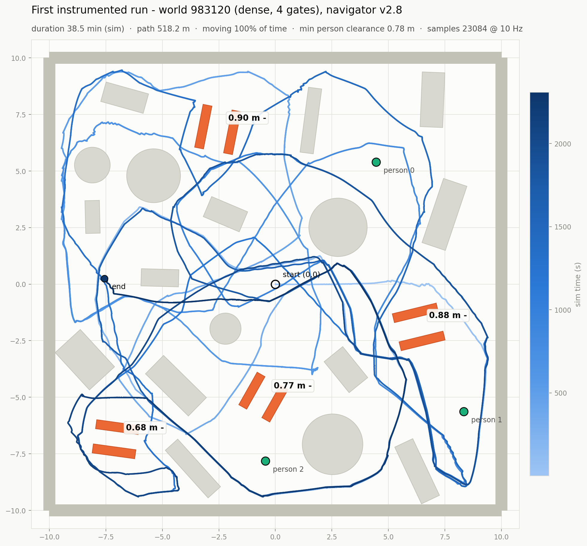

**Trajectory across rooms.** An early two-room world: a check that the navigator
actually crosses doors instead of orbiting one room.
(`plot_run2.py`)

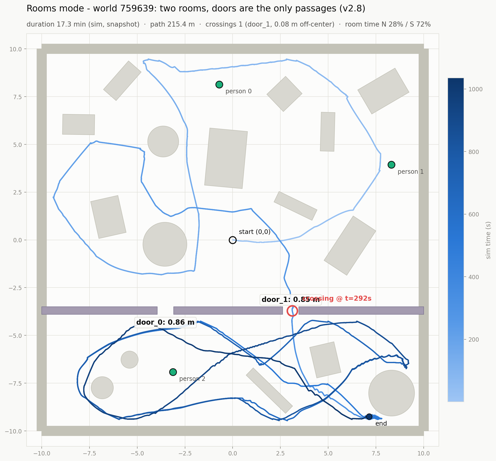

## Experiment 1: reactive navigation vs door width

**The gain over v1, and every door crossed or not.** Top: the v1 baseline, which
reached a terminal deadlock in all 25 worlds, against v2.9.1 in the same worlds: no
deadlock, 3.70 km driven instead of 245 m and 36 door crossings instead of 3. Bottom:
each of the 38 doors v2.9.1 approached, at its width, filled when crossed. It crossed
2 of 7 below the 0.66 m nominal minimum (0.42 m body plus 0.12 m inflation on each
side), 10 of 17 between 0.66 and 0.80 m and 12 of 14 between 0.80 and 0.95 m. The
counts are small, so the shares show a trend, not a threshold. (`plot_curve.py`,
counts from `analyze_batch.py` and `compare_v1_v2.py`)

**Why version 2 exists.** The v1 baseline reached a terminal deadlock in all 25
worlds (median onset 24 s), and v2.9.1 in none. Same worlds, same seeds, and only the
navigator changed. (`plot_compare.py`, stats from `compare_v1_v2.py`)

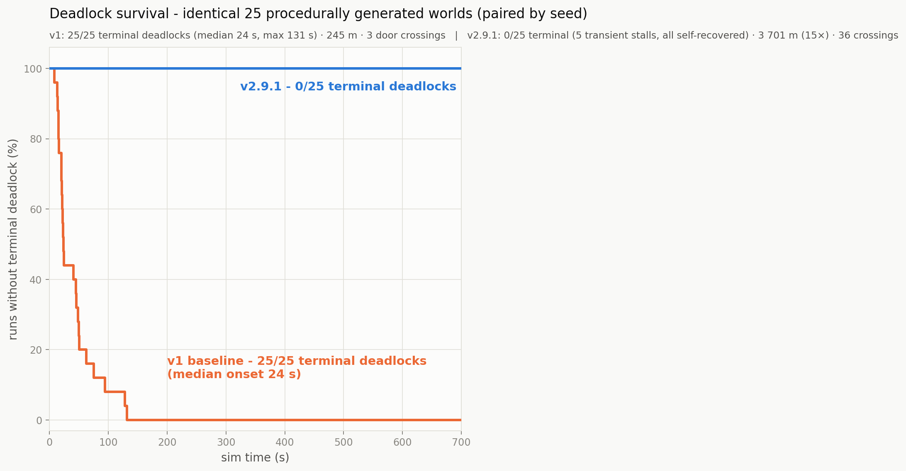

**Before and after, one world.** Seed 013 side by side: v1 stops for good after
16 s and 4.7 m, v2.9.1 covers 162 m and crosses doors five times, including the
0.57 m one, the narrowest door crossed in the batch. (`plot_before_after.py`)

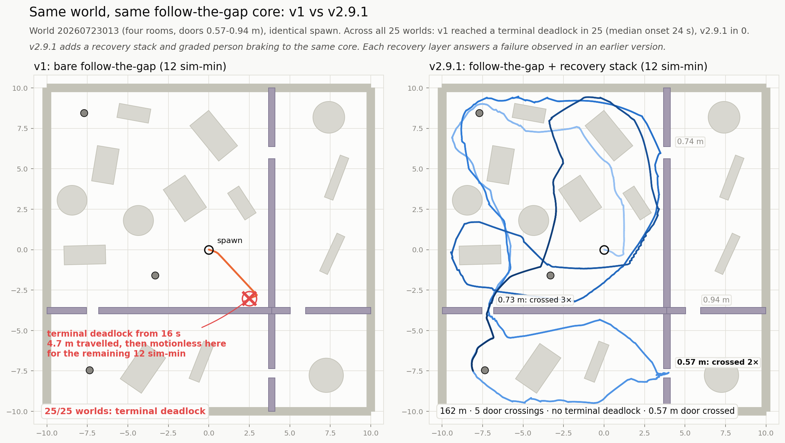

## Experiment 2: the cost of walking people

**One run among walking people.** World 192691, 79 simulated minutes with three
walkers: the robot's trajectory, the people's paths, and the distance from the robot
to the nearest person over time (centre to centre), with the closest pass marked.
(`plot_dynamic.py`)

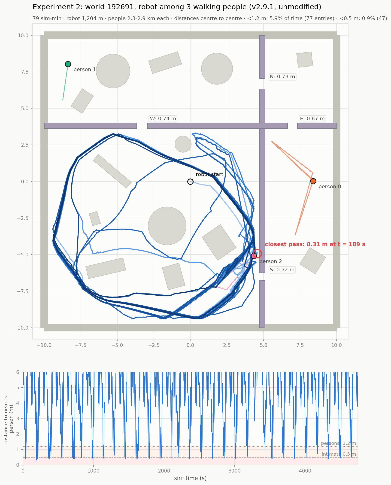

**The first dynamic batch.** 25 worlds with walking people, compared with the static
runs: speed unchanged, no terminal deadlock, walkers shoved the robot in at least 7 runs, and
the forensics of the 16 runs the first watchdog killed (all of them were moving). The
experiment 2 results use the second, full-length batch below.
(`plot_cost_of_dynamics.py`)

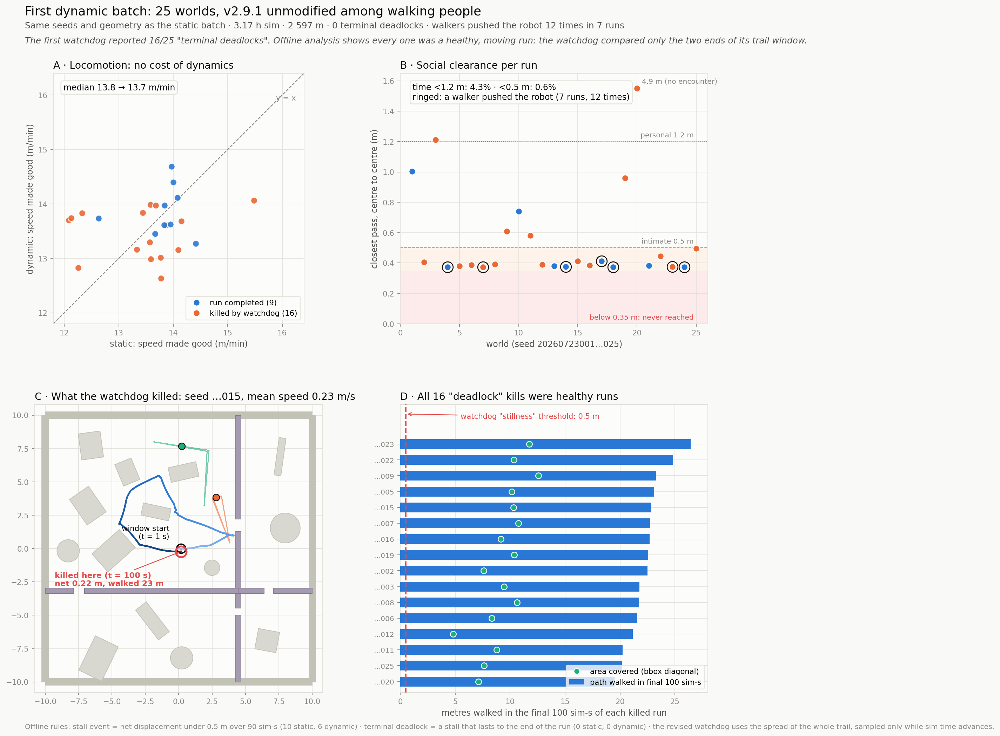

**The experiment 2 figure.** The second dynamic batch: speed seed by seed, closest
pass per run (median 0.41 m, never below 0.38 m, centre to centre, ringed where a
walker pushed the robot), door crossings by width, and the watchdog field test
(16 false kills before the fix, 0 after). (`plot_phase2_final.py`)

**Contested doorways.** One walker per world is routed through a door to a
neighbouring room (the widest one with a clear route). Encounters at that door go
from 26 to 54, the robot keeps using it (17 crossings in both conditions), and
walkers shove the robot in at least 12 of 25 runs. Panel C
shows the closest pass of the 75 runs: the walker comes up behind the robot at a
0.67 m door and pushes it 3 m. (`plot_xroom.py`)

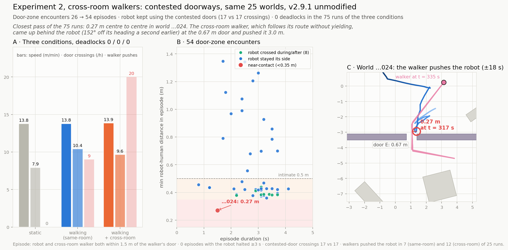

## Experiment 3: mapping while people walk

**The mapping batch.** All 25 worlds mapped autonomously in one unattended session. Grey is
the mapped occupancy, red the manifest ground truth, and the label the
wall-surface coverage. Median 68.7%, range 51.5–94.5%. (`plot_slam_batch.py`)

**Walking vs frozen people, one world.** The same world mapped twice. With the
people frozen in place, the map records each of them as an obstacle (the small
circles in panel B). With the people walking, slam_toolbox clears most of them:
64 phantom cells (0.16 m²), 41 of them on their paths, against 143 cells (0.36 m²)
with the people frozen. (`compare_maps.py`)

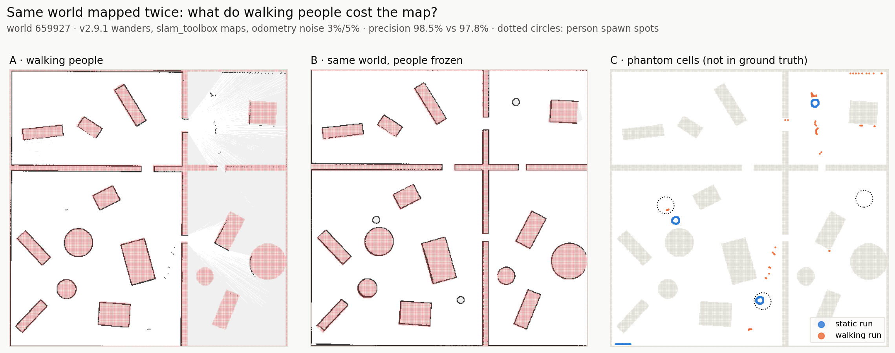

**Odometry-noise ablation, one world.** Four mapping runs at three noise tiers
(0/0 twice, 3%/5%, 8%/10%): occupied precision stays between 98.5% and 99.9%
with no trend in the noise level, also in the run with up to 7.2 m of measured raw
drift. Coverage varies more (67.7-87.6%), with the route each run happened to take.
(`plot_ablation.py`)

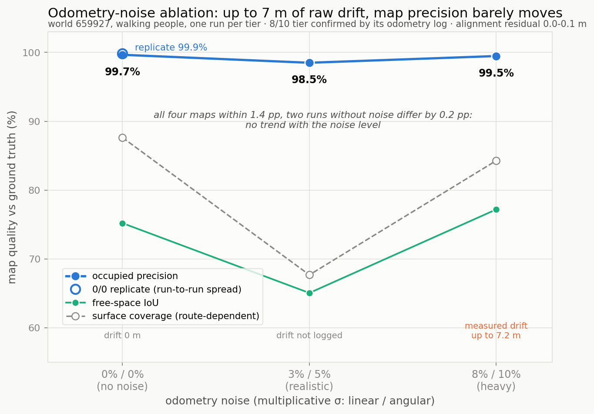

**Map-vs-truth evaluation, one world.** The overlay behind the map metrics: mapped
occupancy (grey) against the manifest geometry (red). `evaluate_map.py` also prints
occupied precision, surface coverage, free-space IoU and a per-room breakdown.

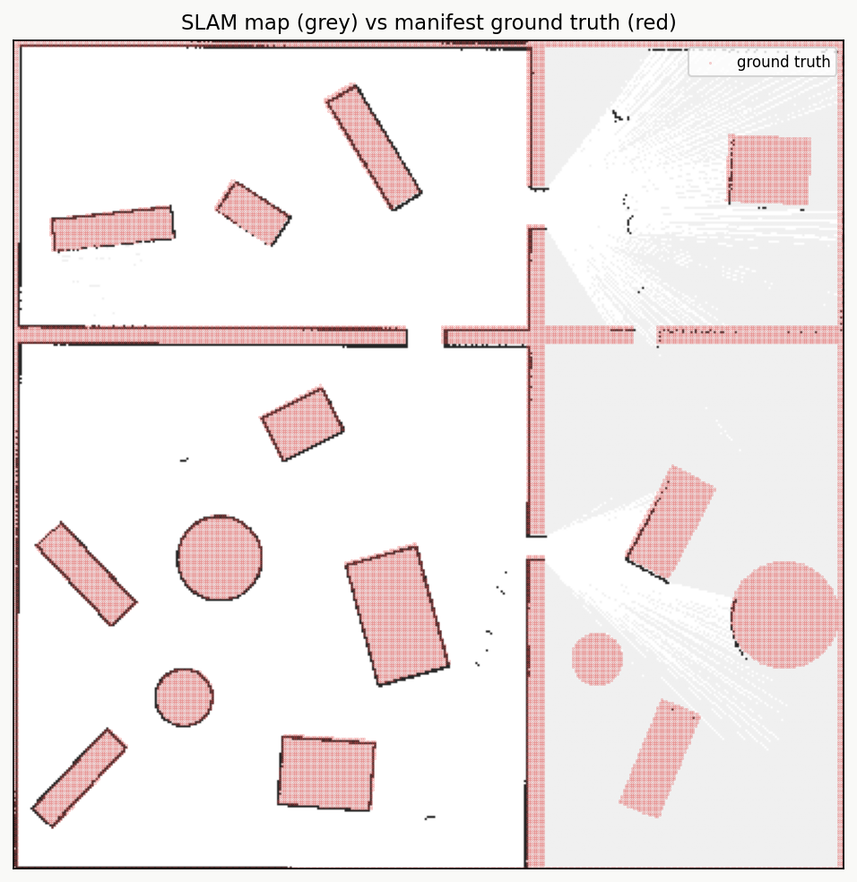

## Experiments 4 and 5: missions on self-built maps

**The paired mission matrices.** 25 worlds × 4 goals, baseline AMCL (v8, left) vs
AMCL tuned for sparse maps (v9, right), every cell checked against ground truth.
Dotted cells: goals the offline reachability check calls infeasible on that map.
Real arrivals go 11 → 12, and the four worlds the check calls cages refused every
cross-room goal in both configurations. Of the six v8 false arrivals, three (S:
world 006 twice, world 017 once) were reported while the robot still stood at the
spawn point, a Nav2 start-up bug, and tuning removed the other three. World 007 of
the v9 run is the same bug: its tour reported all four goals within 4.3 s and it
is excluded. (`plot_paired_missions.py`)

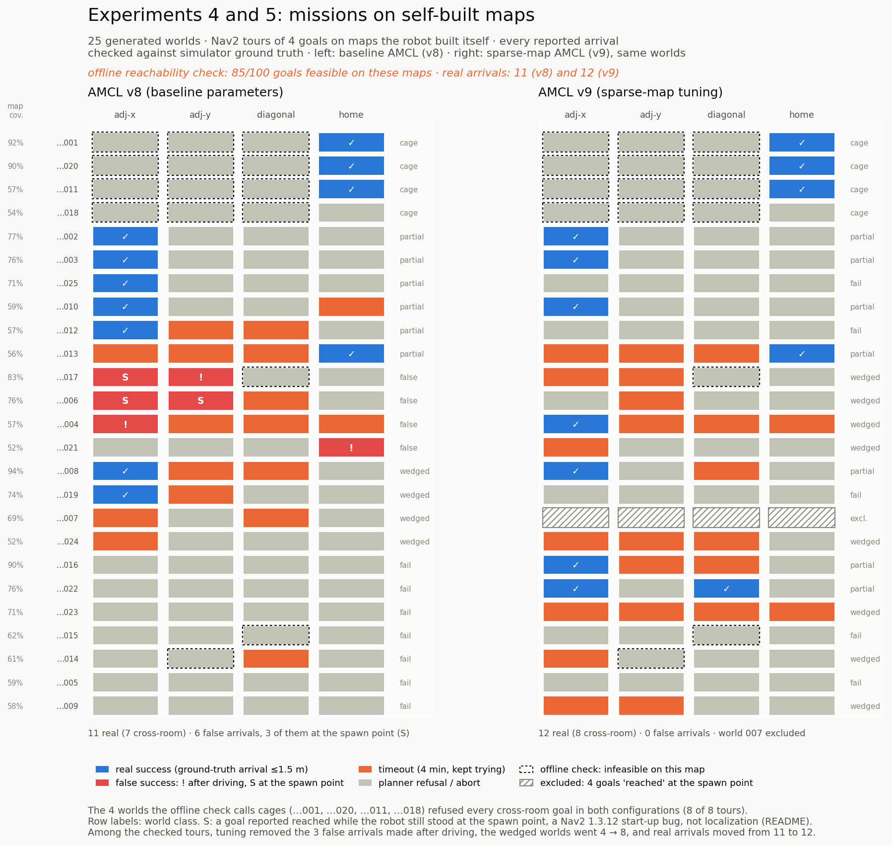

## Experiments 6, 7, 8 and 5b: the configuration and the map

**The revised configuration at a glance.** Real arrivals of the revised configuration
on perfect maps and on the robot's own SLAM maps of the 25 benchmark worlds, and on
perfect maps of 10 worlds generated after the configuration was frozen.
(`plot_missions_headline.py`, numbers from `stats_missions.py` and `stats_batch_b.py`)

**The 2 × 2, world by world.** The first configuration (v9) and the revised one, each
on perfect maps rendered from the manifests and on the robot's own SLAM maps, in the
same 25 worlds, with 120 simulated seconds per attempt and a real arrival defined as a
reported success within 0.6 m of the true position (6, 9, 79 and 44 of 100). Each row
is one paired comparison: the 25 worlds as squares shaded by the goals gained or lost
in that world, and the mean change per world with its 95% bootstrap interval. The
revised configuration did better in 24 of 25 worlds on perfect maps and worse in none.
With v9 the map makes no difference, with the revised configuration it is worth 1.4
goals per world. (`plot_missions_2x2.py`, numbers from `stats_missions.py`)

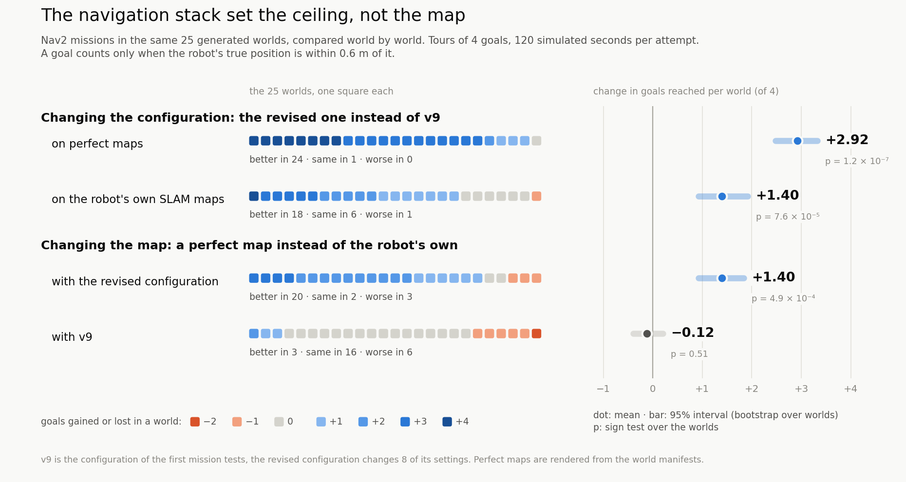

**AMCL and in-place turns.** World 003 on its perfect map. v9 tracks the chassis
centre, 0.10 m ahead of the wheel axle, so every in-place turn (grey bands) reads to
the motion model as a sideways step: the error stays near 0.1 m until the first
in-place turns, then climbs to 12 m within a minute. The revised configuration
tracks the axle and stays below 0.2 m. The table counts, over all worlds, the AMCL
updates whose error grew by more than 0.5 m: 88% of v9's followed an in-place turn.
(`plot_amcl_turns.py`)

**Why goal attempts failed.** One primary label per failed attempt, from the logged
evidence and the ground truth. v9 fails most often by losing localization, and a
missing route, its collision monitor's stop circle and the drive's deadband account
for most of the rest. The revised configuration on perfect maps most often runs out
of recoveries or time. On SLAM maps it loses localization where the map is blank and
plans through unexplored space that is blocked in truth. (`plot_failure_mechanisms.py`, labels from
`failure_mechanisms.py`)

